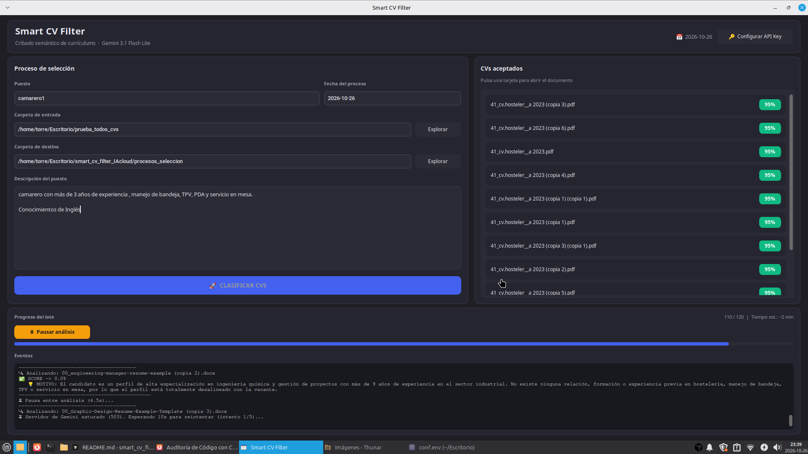
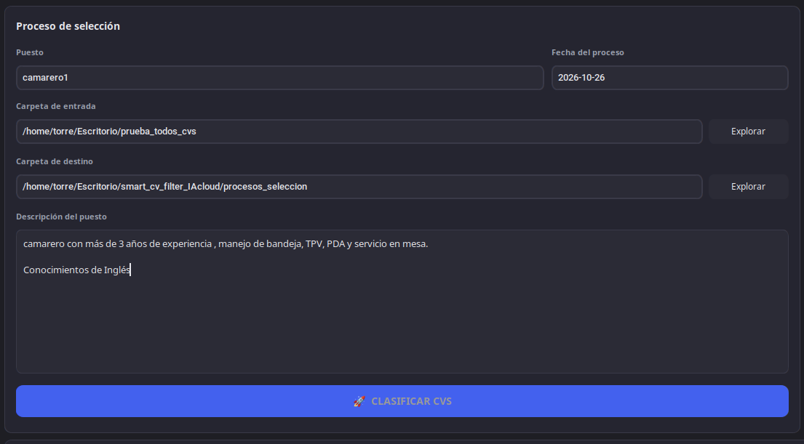
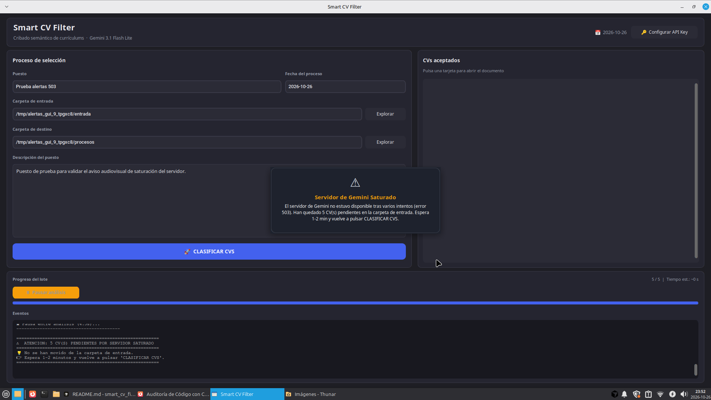

# 🚀 Smart CV Filter — Cloud Edition (Google Gemini)

**Smart CV Filter** es una herramienta de escritorio para el cribado semántico de currículums. Utiliza la API de **Google Gemini** (`gemini-3.1-flash-lite` vía Google AI Studio) para puntuar cada CV frente a una descripción de puesto, sin modelos locales pesados.


## 🖥️ Capturas de Pantalla

<p align="center">
  
  
  
  
</p>
---

## ✨ Características

- Inferencia en la nube con `gemini-3.1-flash-lite`.
- Score, decisión (apto) y motivo técnico por candidato.
- Reanudación de procesos existentes (`RECLUTADOS` / `DUDAS` / `DESCARTADOS`).
- Informe `resumen_proceso.csv` por lote.
- Alertas no bloqueantes, pausa cooperativa y reintentos ante 429/503/timeout.
- La API Key se pide en el primer arranque; la aplicación guarda la configuración sola.

---

## 🛠️ Stack técnico

| Capa | Tecnología |
|------|------------|
| Lenguaje | Python 3.x |
| Frontend | CustomTkinter — `src/frontend/main_gui.py` |
| Motor IA | Google Gemini API (`gemini-3.1-flash-lite`) |
| Extracción | PyMuPDF (`fitz`), python-docx, TXT |
| Red / config | `requests`, `python-dotenv` |
| Empaquetado | PyInstaller — `SmartCVFilter.spec` |
| Dependencias | `requirements.txt` (producción), `requirements-dev.txt` (tests y build) |

---

## ⚙️ Guía de Inicio Rápido

La aplicación es compatible con **Linux** y **Windows**. Necesitas una [API Key de Google Gemini](https://aistudio.google.com/apikey) y conexión a internet. **No crees ni edites ningún archivo de configuración a mano:** la ventana de la aplicación lo gestiona.

### Opción A — Ejecutable / binario nativo

Sin Python ni librerías. Descarga el compilado de **Releases** o **Artifacts** del repositorio en GitHub.

**Windows.** Descarga **`SmartCVFilter-Windows.zip`**.

1. Descomprime el ZIP en la carpeta que prefieras.
2. Ejecuta **`SmartCVFilter.exe`**.
3. En el **primer inicio**, un cuadro emergente te pedirá la API Key de Gemini. La aplicación crea y persiste la configuración de forma transparente junto al `.exe`.
4. Los procesos quedan en `procesos_seleccion/`, al mismo nivel que el ejecutable.

**Linux.** Descarga el compilado **`Smart_cv_filter`**.

1. Colócalo en la carpeta que prefieras y, si hace falta, dale permiso de ejecución (`chmod +x Smart_cv_filter`).
2. Ejecuta **`Smart_cv_filter`**.
3. En el **primer inicio**, un cuadro emergente te pedirá la API Key de Gemini. La aplicación crea y persiste la configuración de forma transparente junto al binario.
4. Los procesos quedan en `procesos_seleccion/`, al mismo nivel que el ejecutable.

Si prefieres generar el binario tú mismo, usa PyInstaller (`pyinstaller SmartCVFilter.spec`) como se indica en la Opción B.

Puedes cambiar la clave más adelante con el botón **🔑 Configurar API Key**.

### Opción B — Ejecución con Python (vía directa recomendada)

Es la vía directa recomendada tanto para **usuarios de Linux** como para **desarrolladores** en general.

```bash
git clone https://github.com/Tebagl/smart_cv_filter_IAcloud.git
cd smart_cv_filter_IAcloud

python3 -m venv .venv
source .venv/bin/activate

pip install -r requirements.txt
python src/frontend/main_gui.py
```

Al arrancar, si no hay clave, aparece el mismo cuadro emergente que en la Opción A.

Herramientas de test, lint y empaquetado:

```bash
pip install -r requirements-dev.txt
python tests/test_alertas_gui.py
pyinstaller SmartCVFilter.spec
```

---

## 📖 Uso

1. Indica el puesto y la carpeta de destino (por defecto `procesos_seleccion/`).
2. Selecciona la carpeta de entrada con CVs (`.pdf`, `.docx`, `.txt`).
3. Pega la descripción del puesto y pulsa **🚀 CLASIFICAR CVS**.
4. El panel de Eventos muestra progreso, ETA (~11.5 s/CV), reintentos (solo texto) y avisos.
5. Los candidatos aceptados (`RECLUTADOS`, score ≥ 60) aparecen en la lista de la derecha.
6. Puedes pausar y reanudar el lote. Tras 5 fallos consecutivos de saturación (503), la pausa es automática.

Los CVs que fallan por cuota, timeout, 503 o JSON incompleto **no se mueven**: siguen en la carpeta de entrada para un nuevo CLASIFICAR.

---

## 📂 Almacenamiento

```text
procesos_seleccion/
└── YYYY-MM-DD_NombrePuesto/
    ├── descripcion_puesto.txt
    ├── resumen_proceso.csv
    ├── RECLUTADOS/
    ├── DUDAS/
    └── DESCARTADOS/
```

---

## 🧩 Arquitectura y módulos

### Frontend (`src/frontend/`)

**`main_gui.py`** — dashboard CustomTkinter. El análisis corre en un hilo de fondo con colas hacia la UI (log, progreso, tarjetas). Las alertas de saturación, lote pendiente o clave inválida son banners **`CTkToplevel` no bloqueantes** (`trigger_alert_notice`: tema oscuro, autocierre 2 s, aviso acústico). Los reintentos HTTP 1–4 no abren ventana; solo se registran en Eventos. Pausa/reanudación cooperativa con `threading.Event`.

### Backend (`src/backend/`)

- **`analyzer.py`**: HTTPS a Gemini (`gemini-3.1-flash-lite`), temperature 0 y JSON estricto. Hasta 5 intentos ante **429** (Retry-After o backoff 10 / 20 / 35 / 50 s) y ante **503/5xx** o timeout; el CV queda pendiente (`server_busy`, cuota o timeout) sin puntuar 0.
- **`cv_handler.py`**: extracción (PyMuPDF / python-docx), anonimización local, clasificación física y CSV.
- **`process_manager.py`**: alta o reanudación de carpetas de proceso y `descripcion_puesto.txt`.
- **`anonymizer.py`**: ofuscación de datos sensibles antes de enviar texto a la API.
- **`extractor.py`**: extractor legado; la GUI de producción usa `cv_handler.py`.

---

## 🔒 Privacidad

- Tráfico con Gemini cifrado por HTTPS.
- Resultados, CSV y copias de CVs permanecen en el equipo del usuario.
- La configuración de la API Key se genera en runtime junto a la aplicación y **no se incluye** en el empaquetado (`SmartCVFilter.spec`).

---
## 📋 Cumplimiento Normativo (RGPD / AI Act)

Smart CV Filter se proporciona como software de soporte técnico. El uso de herramientas de IA en procesos de selección está sujeto a regulaciones estrictas (incluida la calificación de **Alto Riesgo** bajo el **EU AI Act**).

Ponemos a disposición de las organizaciones las siguientes guías de referencia:
* [Guía de Cumplimiento RGPD, LOPDGDD y AI Act](docs/compliance_rgpd_ai_act.md)
* [Modelo Orientativo de Cláusula Informativa para Candidatos](docs/plantilla_clausula_candidatos.md)

*Es responsabilidad exclusiva de la entidad que opera el software asegurar el cumplimiento legal, realizar la correspondiente EIPD y garantizar la supervisión humana efectiva de todas las decisiones.*

---
## ⚖️ Licencia

Este software se distribuye bajo la **GNU GPL v3.0**. Puedes usarlo, estudiarlo, modificarlo y redistribuirlo según los términos de esa licencia.

Se entrega **«tal cual» (as is)**, **sin garantías** de ningún tipo, expresas o implícitas, incluyendo —sin limitarse a— comerciabilidad, idoneidad para un fin concreto y ausencia de errores. El autor **no asume responsabilidad** por daños, pérdidas de datos, interrupciones de servicio (incluida la API de Gemini) ni resultados de contratación derivados del uso. El autor **no tiene obligación de mantenimiento, soporte ni actualizaciones futuras**.

Consulta el texto completo de la GPL v3.0 en el archivo `LICENSE` del repositorio, si está presente, o en [gnu.org/licenses/gpl-3.0](https://www.gnu.org/licenses/gpl-3.0.html).
